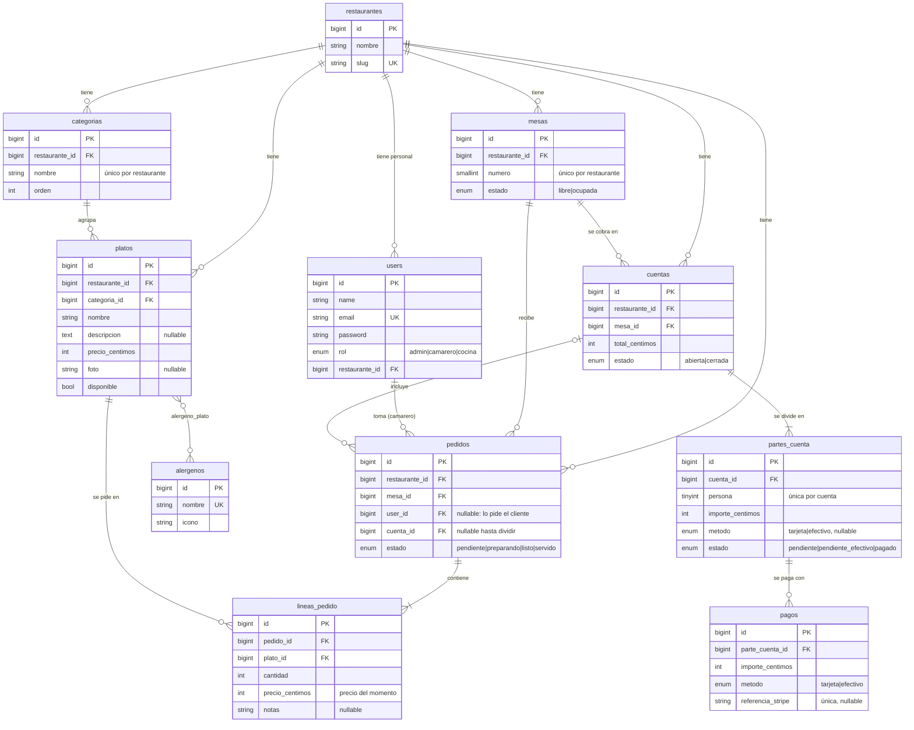

# Diseño técnico de MesaYa

Cómo está construida la aplicación: arquitectura, base de datos y rutas. El diseño **visual** (colores, pantallas) está en `docs/design/DesignFrontend/`.

Estado a 23/11/2026: ramas 1 a 12 en `main` y la 13 (estadísticas) en revisión.

---

## 1. Arquitectura

| Capa | Tecnología | Dónde está |
|---|---|---|
| Rutas | Laravel 13 | `routes/web.php` (aplicación) y `routes/auth.php` (login de Breeze) |
| Controladores | Uno por pantalla y rol | `app/Http/Controllers/{Admin,Camarero,Cocina,Cliente}/` |
| Validación | Form Requests | `app/Http/Requests/` |
| Lógica de negocio | Clases «acción» | `app/Acciones/CrearPedido.php`, `app/Acciones/DividirCuenta.php` |
| Modelos | Eloquent | `app/Models/` |
| Aislamiento | Trait con *global scope* | `app/Models/Concerns/PerteneceARestaurante.php` |
| Roles | Middleware `rol:...` | `app/Http/Middleware/ComprobarRol.php` |
| Vistas | Blade + Tailwind 3 + Alpine.js | `resources/views/` (componentes en `components/`) |
| JavaScript | Alpine y polling con `fetch` | `resources/js/` (`carrito.js`, `avisos-camarero.js`) |
| Base de datos | MySQL | `database/migrations/`, `database/seeders/` |

### Decisiones importantes

- **Aislamiento por restaurante.** Los modelos de negocio (`Categoria`, `Plato`, `Mesa`, `Pedido`, `Cuenta`) usan el trait `PerteneceARestaurante`: si hay alguien logueado, todas las consultas añaden `where restaurante_id = <el suyo>` y, al crear, se rellena solo. `LineaPedido` y `ParteCuenta` no tienen `restaurante_id`: quedan aisladas a través de su pedido o su cuenta.
- **Pantallas públicas del cliente.** Ahí no hay nadie logueado (o puede haber un admin de otro restaurante probando), así que el trait no sirve: se quita con `withoutGlobalScope('restaurante')` y se filtra **a mano** por el restaurante del slug de la URL (`Mesa::delQr()`).
- **Un solo sitio para las reglas de dinero y pedidos.** `CrearPedido` (comanda del camarero y autopedido) y `DividirCuenta` (reparto de la cuenta) trabajan dentro de transacciones: o se guarda todo, o nada.
- **Dinero en céntimos** (enteros) en todas las columnas `_centimos`.
- **Tiempo real con polling:** las pantallas de cocina, avisos del camarero y estado del pedido piden datos JSON cada ~5 s.
- **Estadísticas con consultas agregadas** (`App\Estadisticas\EstadisticasRestaurante`): un método por gráfico, cada uno con una consulta `SUM` / `COUNT` / `GROUP BY`. `pagos` no tiene `restaurante_id`, así que se llega al restaurante con `pagos → partes_cuenta → cuentas` y se filtra a mano por `cuentas.restaurante_id` (el global scope no actúa en consultas con `DB::table()` y joins). Ventas = pagos. Zona horaria `Europe/Madrid`.
- **Carrito del cliente en `localStorage`:** la base de datos no se toca hasta que se envía el pedido.
- **QR en PDF con página imprimible** (`/admin/mesas/imprimir` y «Guardar como PDF» del navegador), sin librerías de PDF.

---

## 2. Base de datos

### Diagrama entidad-relación



### Tablas

| Tabla | Modelo | Rama | Notas |
|---|---|---|---|
| `restaurantes` | `Restaurante` | 1 | El `slug` sale en la URL del QR, por eso es único. |
| `users` | `User` | Laravel + 1 | Se añaden `rol` y `restaurante_id`. No usa el trait (Laravel la consulta para saber quién está logueado). |
| `categorias` | `Categoria` | 3 | No se puede borrar si tiene platos. |
| `platos` | `Plato` | 3 | Foto en `storage/app/public/platos`. |
| `alergenos` | `Alergeno` | 3 | Los 14 legales, **comunes a todos los restaurantes** (sin `restaurante_id`). Los crea `AlergenosSeeder`. |
| `alergeno_plato` | *(pivote)* | 3 | Clave primaria doble (alergeno_id, plato_id). |
| `mesas` | `Mesa` | 4 | Número único por restaurante. |
| `pedidos` | `Pedido` | 5 | `user_id` vacío si pide el cliente. `cuenta_id` se añade en la rama 10. |
| `lineas_pedido` | `LineaPedido` | 5 | Guarda el precio del momento del pedido. |
| `cuentas` | `Cuenta` | 10 | Pasa a `cerrada` con `Cuenta::cerrar()`, que solo cierra si todas las partes están pagadas y no hay pedidos fuera de la cuenta (rama 12). |
| `partes_cuenta` | `ParteCuenta` | 10 | `metodo` vacío hasta pagar. Los cambios de estado solo se hacen con `pedirEfectivo()`, `confirmarEfectivo()` y `pagarConTarjeta()` (rama 12). |
| `pagos` | `Pago` | 11 | Sin `restaurante_id`: queda aislada por parte → cuenta. `referencia_stripe` es el id de la sesión de Stripe Checkout y es **única** (la misma sesión no se registra dos veces). No se puede borrar una parte con pagos. |

### Estados y reglas

- **Pedido:** `pendiente` → `preparando` → `listo` → `servido`. Solo se avanza un paso cada vez (`Pedido::cambiarEstado()`); **no se puede saltar de `pendiente` a `listo`**.
- **Mesa:** `libre` → `ocupada` al hacer el primer pedido → `libre` cuando el camarero cierra la cuenta (botón «Cerrar mesa y liberar», rama 12).
- **Parte de la cuenta:** `pendiente` → `pagado` (tarjeta) o `pendiente` → `pendiente_efectivo` → `pagado` (efectivo). El cliente solo puede llegar a `pendiente_efectivo`; el `pagado` en efectivo lo pone el camarero. Si el camarero cobra en efectivo en la mesa sin que el cliente haya elegido nada (`cobrarEfectivoEnMesa()`), hace los dos pasos seguidos. El TPV del bar (`pagarConTpv()`) va de `pendiente` a `pagado` con `metodo = tarjeta` y un `Pago` **sin** `referencia_stripe`: así se distingue de Stripe. Una parte pagada no se vuelve a cobrar.
- **Pedidos después de dividir:** si la cuenta ya tiene pagos, `DividirCuenta` solo divide lo nuevo y añade partes detrás de las que había (personas 4, 5…). Mientras haya pedidos fuera de la cuenta, la mesa no se puede cerrar.
- **Reparto a partes iguales:** división entera y el céntimo que sobra a la primera parte. Ejemplo: 31,00 € entre 3 → 10,34 + 10,33 + 10,33.
- **La suma de las partes es siempre exactamente el total** (`DividirCuenta` lo comprueba antes de guardar).

---

## 3. Rutas

### Públicas (cliente, sin login)

| Método | URL | Nombre | Qué hace |
|---|---|---|---|
| GET | `/r/{slug}/mesa/{numero}` | `cliente.carta` | Carta del QR (solo platos disponibles) |
| GET | `/r/{slug}/mesa/{numero}/pedido` | `cliente.pedido` | «Mi pedido» (carrito) |
| POST | `/r/{slug}/mesa/{numero}/pedido` | `cliente.pedido.enviar` | Envía el pedido a cocina (máx. 10/min) |
| GET | `/r/{slug}/mesa/{numero}/estado` | `cliente.estado` | Estado de los pedidos del cliente |
| GET | `/r/{slug}/mesa/{numero}/estado/datos` | `cliente.estado.datos` | JSON para el polling |
| GET | `/r/{slug}/mesa/{numero}/cuenta` | `cliente.cuenta` | Ver y dividir la cuenta |
| POST | `/r/{slug}/mesa/{numero}/cuenta` | `cliente.cuenta.dividir` | Divide la cuenta (máx. 20/min) |
| GET | `/r/{slug}/mesa/{numero}/cuenta/partes/{parte}/tarjeta` | `cliente.pago.tarjeta` | Resumen de la parte antes de pagar con tarjeta |
| POST | `/r/{slug}/mesa/{numero}/cuenta/partes/{parte}/tarjeta` | `cliente.pago.pagar` | Crea la sesión de Stripe Checkout y redirige a Stripe (máx. 10/min) |
| GET | `/r/{slug}/mesa/{numero}/cuenta/partes/{parte}/pagado` | `cliente.pago.exito` | Vuelta de Stripe: consulta la sesión y, si está pagada, guarda el pago |
| GET | `/r/{slug}/mesa/{numero}/cuenta/partes/{parte}/cancelado` | `cliente.pago.cancelado` | Vuelta de Stripe sin pagar: la parte sigue pendiente |
| POST | `/r/{slug}/mesa/{numero}/cuenta/partes/{parte}/efectivo` | `cliente.pago.efectivo.elegir` | El cliente elige efectivo: `pendiente` → `pendiente_efectivo` (máx. 10/min) |
| GET | `/r/{slug}/mesa/{numero}/cuenta/partes/{parte}/efectivo` | `cliente.pago.efectivo` | Pantalla «Avisa al camarero, vendrá a cobrarte» |

### Admin (`auth` + `rol:admin`)

| Método | URL | Nombre |
|---|---|---|
| GET | `/dashboard` | `dashboard` |
| GET | `/admin/carta` | `admin.carta` |
| GET · POST | `/admin/carta/platos/crear` · `/admin/carta/platos` | `admin.carta.crear` · `admin.carta.guardar` |
| GET · PUT · DELETE | `/admin/carta/platos/{plato}/editar` · `/admin/carta/platos/{plato}` | `admin.carta.editar` · `.actualizar` · `.borrar` |
| PATCH | `/admin/carta/platos/{plato}/disponibilidad` | `admin.carta.disponibilidad` |
| GET · POST · PUT · DELETE | `/admin/carta/categorias[/{categoria}]` | `admin.carta.categorias[.guardar/.actualizar/.borrar]` |
| GET | `/admin/alergenos` | `admin.alergenos` |
| GET | `/admin/estadisticas` | `admin.estadisticas` |
| GET · POST · PUT · DELETE | `/admin/mesas[/crear, /{mesa}, /{mesa}/editar]` | `admin.mesas[.crear/.guardar/.editar/.actualizar/.borrar]` |
| GET | `/admin/mesas/imprimir` | `admin.mesas.imprimir` |

### Camarero (`auth` + `rol:camarero`)

| Método | URL | Nombre |
|---|---|---|
| GET | `/camarero/mesas` | `camarero.mesas` |
| GET · POST | `/camarero/mesas/{mesa}/comanda` | `camarero.comanda.crear` · `camarero.comanda.guardar` |
| GET | `/camarero/avisos` · `/camarero/avisos/datos` | `camarero.avisos` · `camarero.avisos.datos` |
| PATCH | `/camarero/avisos/{pedido}/servido` | `camarero.avisos.servido` |
| GET | `/camarero/mesas/{mesa}` | `camarero.mesas.detalle` |
| PATCH | `/camarero/mesas/{mesa}/partes/{parte}/cobrar` | `camarero.mesas.cobrar` |
| POST | `/camarero/mesas/{mesa}/cerrar` | `camarero.mesas.cerrar` |
| POST | `/camarero/mesas/{mesa}/dividir` | `camarero.mesas.dividir` |
| GET | `/camarero/cobros` | `camarero.cobros` |

### Cocina (`auth` + `rol:cocina`)

| Método | URL | Nombre |
|---|---|---|
| GET | `/cocina/pedidos` · `/cocina/pedidos/datos` | `cocina.pedidos` · `cocina.pedidos.datos` |
| PATCH | `/cocina/pedidos/{pedido}/estado` | `cocina.pedidos.estado` |

### Todos los roles

`/login`, `/logout`, `/forgot-password`, `/reset-password/{token}` y `/profile` (Breeze, traducido). **No hay registro público.**

> El admin pasa siempre el middleware `rol:...`, así que también puede entrar en las pantallas de camarero y cocina.

---

## 4. Estructura de carpetas (lo nuestro)

```
app/
  Acciones/             CrearPedido, DividirCuenta
  Servicios/            PasarelaStripe (único sitio que habla con Stripe)
  Estadisticas/         EstadisticasRestaurante (cálculos de las estadísticas)
  Http/Controllers/     Admin/, Camarero/, Cocina/, Cliente/
  Http/Middleware/      ComprobarRol
  Http/Requests/        validación de cada formulario
  Models/               modelos + Concerns/PerteneceARestaurante
database/
  migrations/           una por tabla
  seeders/              Restaurantes, UsuariosAdmin, Alergenos, Carta, Mesas
resources/
  css/app.css           Tailwind + fuentes locales
  js/                   app.js, carrito.js, avisos-camarero.js
  views/                admin/, camarero/, cocina/, cliente/, components/
tests/
  Feature/              un archivo por funcionalidad
  Unit/                 reparto de la cuenta
```
